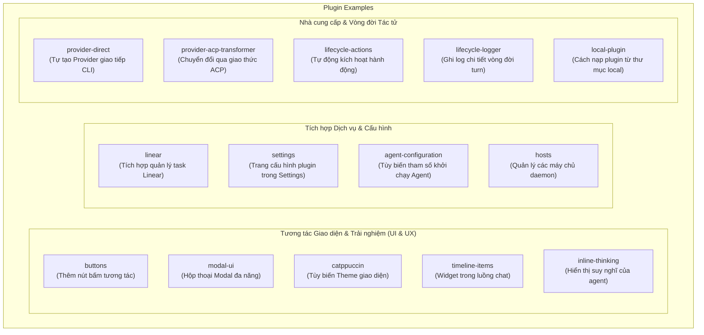

# Plugin Examples (Các Plugin Mẫu của Paseo)

Thư mục này chứa các ví dụ mẫu (sample plugins) minh họa cách xây dựng và mở rộng tính năng trong hệ sinh thái Paseo, từ việc tích hợp giao diện người dùng (UI components), các móc nối vòng đời (lifecycle hooks), đến các bộ chuyển đổi tác tử (agent providers & ACP transformers).

---

## Sơ đồ phân loại các Plugin Mẫu

---

## Danh sách chi tiết các thư mục ví dụ

| Thư mục                        | Chức năng chính                                                   | Tài liệu chi tiết                                                          |
| :----------------------------- | :---------------------------------------------------------------- | :------------------------------------------------------------------------- |
| **`buttons`**                  | Thêm các nút hành động nhanh vào thanh công cụ                    | [`buttons/README.md`](buttons/README.md)                                   |
| **`modal-ui`**                 | Mở modal tùy biến cho người dùng điền biểu mẫu hoặc chọn tùy chọn | [`modal-ui/README.md`](modal-ui/README.md)                                 |
| **`catppuccin`**               | Định nghĩa và áp dụng bảng màu theme Catppuccin cho giao diện     | [`catppuccin/README.md`](catppuccin/README.md)                             |
| **`timeline-items`**           | Hiển thị các khối thông tin mở rộng trên dòng thời gian hội thoại | [`timeline-items/README.md`](timeline-items/README.md)                     |
| **`inline-thinking`**          | Tùy biến hiển thị khối suy nghĩ (chain-of-thought) của tác tử     | [`inline-thinking/README.md`](inline-thinking/README.md)                   |
| **`linear`**                   | Kết nối API Linear để đồng bộ issues vào workspace                | [`linear/README.md`](linear/README.md)                                     |
| **`settings`**                 | Thêm tab cài đặt riêng cho plugin trong giao diện Preferences     | [`settings/README.md`](settings/README.md)                                 |
| **`agent-configuration`**      | Mở rộng form cấu hình agent (nhiệt độ, system prompt, mode)       | [`agent-configuration/README.md`](agent-configuration/README.md)           |
| **`hosts`**                    | Quản lý và theo dõi danh sách các host/server được kết nối        | [`hosts/`](hosts/)                                                         |
| **`provider-direct`**          | Tạo một Agent Provider mới kết nối trực tiếp với CLI              | [`provider-direct/README.md`](provider-direct/README.md)                   |
| **`provider-acp-transformer`** | Chuyển đổi dữ liệu giữa Paseo và Agent Communication Protocol     | [`provider-acp-transformer/README.md`](provider-acp-transformer/README.md) |
| **`lifecycle-actions`**        | Đăng ký các hành động chạy tự động sau mỗi turn của agent         | [`lifecycle-actions/README.md`](lifecycle-actions/README.md)               |
| **`lifecycle-logger`**         | Lắng nghe và ghi nhật ký sự kiện vòng đời phục vụ debug           | [`lifecycle-logger/README.md`](lifecycle-logger/README.md)                 |
| **`local-plugin`**             | Hướng dẫn cấu hình nạp plugin trực tiếp từ đường dẫn máy local    | [`local-plugin/`](local-plugin/)                                           |

---

> 💡 **Xem thêm tài liệu kiến trúc toàn diện của hệ thống Plugin tại:** **[`plugins/README.md`](../plugins/README.md)**
