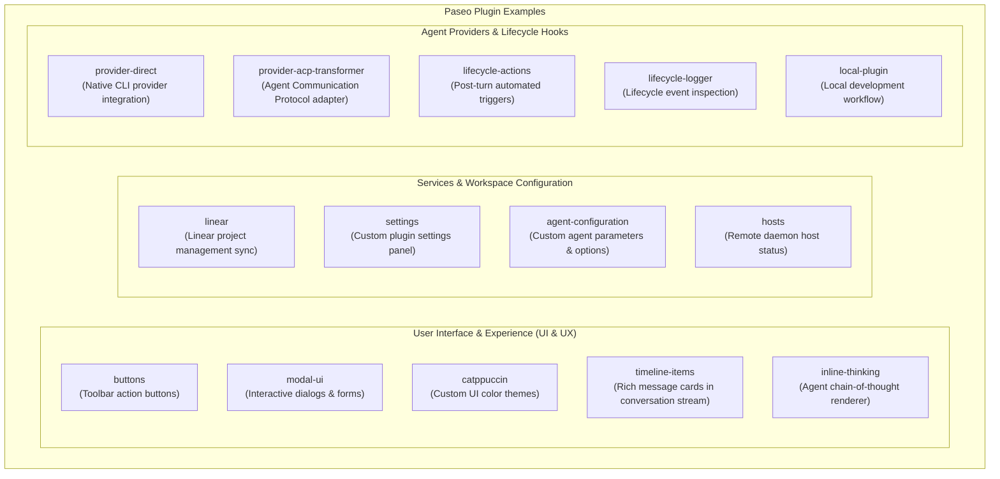

# Paseo Plugin Examples

This directory provides official sample plugins demonstrating how to extend and customize the Paseo ecosystem — ranging from custom UI components and theme palettes to agent lifecycle hooks, service integrations, and direct CLI agent providers.

---

## Plugin Examples Classification

---

## Detailed Directory Catalog

| Directory                      | Key Capabilities                                                     | Documentation Link                                                         |
| :----------------------------- | :------------------------------------------------------------------- | :------------------------------------------------------------------------- |
| **`buttons`**                  | Adds custom interactive action buttons to the chat bar and toolbar   | [`buttons/README.md`](buttons/README.md)                                   |
| **`modal-ui`**                 | Displays interactive modals for user input, forms, and confirmations | [`modal-ui/README.md`](modal-ui/README.md)                                 |
| **`catppuccin`**               | Custom design palette implementing the Catppuccin color scheme       | [`catppuccin/README.md`](catppuccin/README.md)                             |
| **`timeline-items`**           | Renders custom rich cards inside the conversation timeline           | [`timeline-items/README.md`](timeline-items/README.md)                     |
| **`inline-thinking`**          | Renders and formats live agent reasoning tokens (chain-of-thought)   | [`inline-thinking/README.md`](inline-thinking/README.md)                   |
| **`linear`**                   | Connects to Linear to display issues and automate workspace tracking | [`linear/README.md`](linear/README.md)                                     |
| **`settings`**                 | Registers a dedicated plugin configuration tab in Preferences        | [`settings/README.md`](settings/README.md)                                 |
| **`agent-configuration`**      | Extends agent launch options (temperature, system prompt, flags)     | [`agent-configuration/README.md`](agent-configuration/README.md)           |
| **`hosts`**                    | Manages remote daemon connections and host diagnostics               | [`hosts/`](hosts/)                                                         |
| **`provider-direct`**          | Implements a custom agent provider communicating directly with a CLI | [`provider-direct/README.md`](provider-direct/README.md)                   |
| **`provider-acp-transformer`** | Transforms streams to and from Agent Communication Protocol format   | [`provider-acp-transformer/README.md`](provider-acp-transformer/README.md) |
| **`lifecycle-actions`**        | Triggers automated workflows whenever an agent completes a turn      | [`lifecycle-actions/README.md`](lifecycle-actions/README.md)               |
| **`lifecycle-logger`**         | Logs lifecycle events for debugging and analytics                    | [`lifecycle-logger/README.md`](lifecycle-logger/README.md)                 |
| **`local-plugin`**             | Example demonstrating how to develop and link a local plugin         | [`local-plugin/`](local-plugin/)                                           |

---

> 💡 **For architecture details and publishing instructions, see:** **[`plugins/README.md`](../plugins/README.md)**
