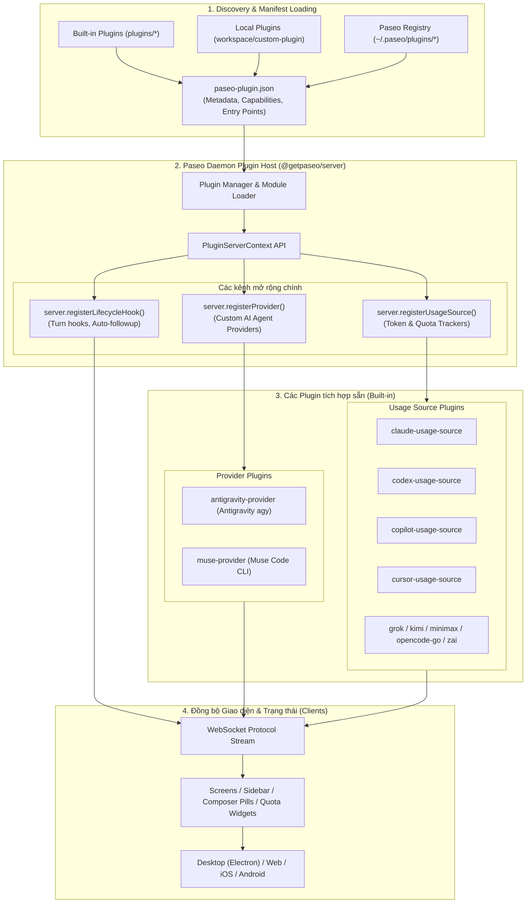
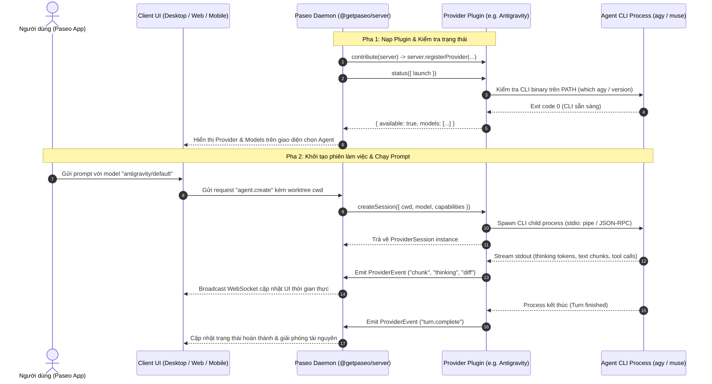
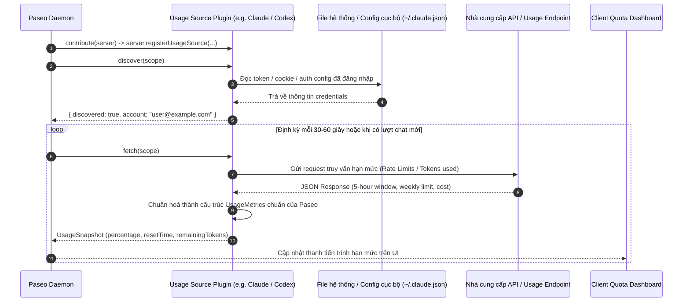

# Hệ Thống Plugin Paseo (Paseo Plugin Architecture)

Hệ thống Plugin của Paseo được thiết kế theo kiến trúc **"Write once, run everywhere"** — Plugin được nạp và thực thi trên **Paseo Daemon** (`@getpaseo/server`), đồng thời tự động đồng bộ trạng thái, giao diện (UI) và vòng đời tác tử tới mọi client kết nối (Desktop Electron, Web, iOS, Android Expo).

---

## 1. Sơ đồ tổng quát kiến trúc Plugin (Plugin Architecture Overview)

Sơ đồ dưới đây mô tả cách Paseo nạp, phân loại và kết nối các Plugin từ máy chủ daemon đến giao diện người dùng trên mọi nền tảng:



---

## 2. Sơ đồ chi tiết luồng vòng đời Provider Plugin (Provider Execution Lifecycle)

Sơ đồ trình tự mô tả cách một **Provider Plugin** (như `antigravity-provider` hoặc `muse-provider`) khởi tạo, kiểm tra khả dụng của CLI trên máy, spawn process và truyền dữ liệu hai chiều:



---

## 3. Sơ đồ chi tiết luồng thu thập Hạn mức (Usage Source Polling & Discovery Flow)

Sơ đồ trình tự mô tả cách các **Usage Source Plugins** tự động phát hiện thông tin cấu hình, quét token/quota định kỳ và cập nhật lên bảng thống kê của Paseo:



---

## 4. Danh sách các Built-in Plugins (`plugins/`)

Thư mục `plugins/` hiện tích hợp sẵn 11 plugins cốt lõi:

| Plugin                         | Loại             | Mục đích                                           | Entry Point       | Phụ thuộc          |
| :----------------------------- | :--------------- | :------------------------------------------------- | :---------------- | :----------------- |
| **`antigravity-provider`**     | Provider         | Kết nối trực tiếp với Antigravity CLI (`agy`)      | `index.server.ts` | CLI `agy`          |
| **`muse-provider`**            | Provider & Usage | Kết nối tác tử Muse Code CLI kiêm theo dõi usage   | `index.server.ts` | Muse CLI           |
| **`claude-usage-source`**      | Usage Source     | Đọc hạn mức 5 giờ, tuần và token của Claude Code   | `index.server.ts` | `~/.claude.json`   |
| **`codex-usage-source`**       | Usage Source     | Đọc token usage, quota và credits của OpenAI Codex | `index.server.ts` | Codex config       |
| **`copilot-usage-source`**     | Usage Source     | Giám sát hạn mức tài khoản GitHub Copilot CLI      | `index.server.ts` | Copilot auth       |
| **`cursor-usage-source`**      | Usage Source     | Giám sát usage và fast requests của Cursor         | `index.server.ts` | Cursor credentials |
| **`grok-usage-source`**        | Usage Source     | Theo dõi hạn mức và số lượt gọi xAI Grok           | `index.server.ts` | Grok auth          |
| **`kimi-usage-source`**        | Usage Source     | Theo dõi token limit và usage của Moonshot Kimi    | `index.server.ts` | Kimi config        |
| **`minimax-usage-source`**     | Usage Source     | Theo dõi usage và quota của MiniMax                | `index.server.ts` | MiniMax API key    |
| **`opencode-go-usage-source`** | Usage Source     | Theo dõi hạn mức OpenCode Go                       | `index.server.ts` | OpenCode config    |
| **`zai-usage-source`**         | Usage Source     | Theo dõi usage của Zai / GLM models                | `index.server.ts` | Zai credentials    |

---

## 5. Các Plugin ví dụ tham khảo (`plugin-examples/`)

Nếu muốn phát triển thêm plugin mở rộng giao diện hoặc tính năng, bạn có thể tham khảo các ví dụ mẫu trong `plugin-examples/`:

- `plugin-examples/provider-direct`: Ví dụ chuẩn tạo Provider kết nối trực tiếp CLI.
- `plugin-examples/provider-acp-transformer`: Ví dụ Provider chuyển đổi qua chuẩn ACP (Agent Communication Protocol).
- `plugin-examples/agent-configuration`: Thêm trường cấu hình tùy biến cho agent.
- `plugin-examples/buttons`: Thêm nút bấm tương tác vào toolbar và chat box.
- `plugin-examples/catppuccin`: Cung cấp theme màu sắc mới cho Paseo.
- `plugin-examples/linear`: Tích hợp quản lý task Linear vào màn hình Paseo.
- `plugin-examples/modal-ui`: Hiển thị modal tương tác người dùng.
- `plugin-examples/timeline-items`: Chèn thêm thông tin/sự kiện vào dòng thời gian của hội thoại.
- `plugin-examples/settings`: Đăng ký trang cài đặt plugin tùy biến trong Settings.

---

## 6. Hướng dẫn tạo Plugin mới

Cấu trúc thư mục tối thiểu của một plugin:

```
my-custom-plugin/
├── paseo-plugin.json      # Metadata và khai báo capabilities
├── icon.svg              # Icon nhận diện
└── index.server.ts       # Server entry point thực thi trên Paseo Daemon
```

### Ví dụ file `paseo-plugin.json`:

```json
{
  "id": "my-custom-provider",
  "name": "My Custom Provider",
  "version": "1.0.0",
  "server": "./index.server.ts"
}
```

### Ví dụ file `index.server.ts`:

```ts
import type { PluginServerContext } from "@getpaseo/plugin/server";

export default function contribute(server: PluginServerContext) {
  // Đăng ký Provider hoặc Usage Source hoặc Hooks
  return () => {
    // Cleanup khi plugin bị disable hoặc server tắt
  };
}
```

Để kiểm tra tính hợp lệ về kiểu dữ liệu toàn bộ plugin:

```bash
npm run typecheck --workspace=@getpaseo/builtin-plugins
```
