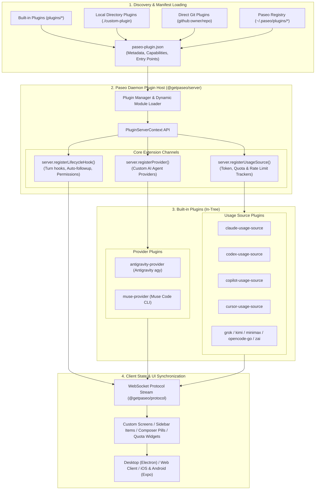
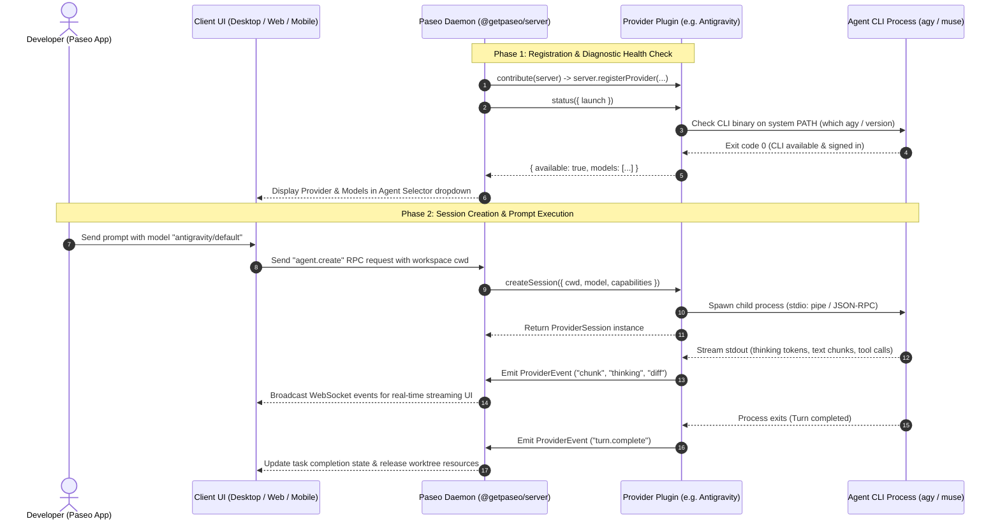
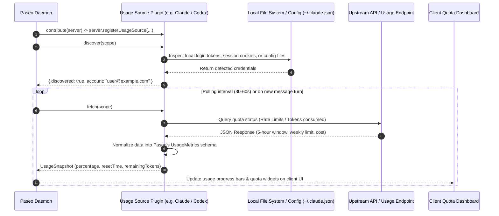

# Paseo Plugin Architecture & Built-in Plugins

The Paseo plugin system is designed around the **"Write once, run everywhere"** paradigm. Plugins execute on the **Paseo Daemon** (`@getpaseo/server`) and seamlessly project their user interface, state, and agent lifecycle hooks to all connected clients (Desktop Electron, Web, iOS, Android React Native).

---

## 1. System Architecture Overview

The following diagram illustrates how Paseo discovers, loads, and coordinates plugins between the daemon host and multi-platform client applications:



---

## 2. Provider Plugin Lifecycle & Execution Flow

This sequence diagram depicts how a **Provider Plugin** (such as `antigravity-provider` or `muse-provider`) registers capabilities, verifies local binary availability, instantiates sessions, spawns agent subprocesses, and streams real-time events to the UI:



---

## 3. Usage Source Discovery & Polling Flow

Usage source plugins monitor quota consumption, window thresholds, and token spending across third-party LLM providers:



---

## 4. Built-in Plugins Catalog (`plugins/`)

The `plugins/` directory contains 11 production-ready built-in plugins:

| Plugin Directory               | Type             | Purpose & Description                              | Discovery Tags                                   | Entry Point       |
| :----------------------------- | :--------------- | :------------------------------------------------- | :----------------------------------------------- | :---------------- |
| **`antigravity-provider`**     | Provider         | Bridges Paseo with Google Antigravity CLI (`agy`)  | `antigravity`, `agy`, `ai-agents`, `provider`    | `index.server.ts` |
| **`muse-provider`**            | Provider & Usage | Integrates Muse Code CLI and tracks resource usage | `muse`, `muse-code`, `coding-assistant`          | `index.server.ts` |
| **`claude-usage-source`**      | Usage Source     | Tracks Claude Code 5-hour and weekly token limits  | `claude`, `anthropic`, `tokens`, `cost-tracking` | `index.server.ts` |
| **`codex-usage-source`**       | Usage Source     | Monitors OpenAI Codex quota, tokens, and credits   | `codex`, `openai`, `quota`, `token-metrics`      | `index.server.ts` |
| **`copilot-usage-source`**     | Usage Source     | Tracks GitHub Copilot CLI quota and plan status    | `copilot`, `github`, `quota`, `metrics`          | `index.server.ts` |
| **`cursor-usage-source`**      | Usage Source     | Monitors Cursor request counts and fast requests   | `cursor`, `cursor-ai`, `fast-requests`, `quota`  | `index.server.ts` |
| **`grok-usage-source`**        | Usage Source     | Tracks xAI Grok usage and rate limits              | `grok`, `xai`, `tokens`, `rate-limits`           | `index.server.ts` |
| **`kimi-usage-source`**        | Usage Source     | Tracks Moonshot Kimi token limits and requests     | `kimi`, `moonshot`, `tokens`, `limits`           | `index.server.ts` |
| **`minimax-usage-source`**     | Usage Source     | Monitors MiniMax API quota and balance             | `minimax`, `api-quota`, `balance`                | `index.server.ts` |
| **`opencode-go-usage-source`** | Usage Source     | Monitors OpenCode Go token limits                  | `opencode`, `pi`, `developer-tokens`             | `index.server.ts` |
| **`zai-usage-source`**         | Usage Source     | Tracks Zai / GLM model limits and metrics          | `zai`, `zhipu`, `glm`, `tokens`                  | `index.server.ts` |

---

## 5. Publishing to the Official Paseo Plugin Registry

The official Paseo Plugin Registry is hosted at **`https://plugins.paseo.sh`** (backed by the [getpaseo/plugins](https://github.com/getpaseo/plugins) GitHub repository). Once published, users worldwide can install your plugin with a single command:

```bash
paseo plugin add owner/slug
```

### Step 1: Plugin Manifest (`paseo-plugin.json`)

Your plugin directory must include a valid `paseo-plugin.json`:

```json
{
  "id": "my-username/my-awesome-plugin",
  "name": "My Awesome Plugin",
  "version": "1.0.0",
  "description": "High-performance coding agent provider for Paseo",
  "license": "Apache-2.0",
  "server": "./index.server.ts",
  "icon": "./icon.svg",
  "categories": ["providers", "tools"]
}
```

- **`id`**: Must match `^[a-z0-9]+(?:-[a-z0-9]+)*\/[a-z0-9]+(?:-[a-z0-9]+)*$` (e.g. `luongndcoder/antigravity-provider`).
- **`icon`**: An SVG or PNG file representing your plugin.
- **`server`**: Entry point for server-side logic (`PluginServerContext`).
- **`client`** _(optional)_: Entry point for UI extensions (`PluginClientContext`).

### Step 2: Choose Distribution Method (npm vs. Git)

Paseo supports two artifact distribution kinds:

1. **npm Package (Recommended)**:
   - Publish your plugin to npm:
     ```bash
     npm publish --access public
     ```
   - The registry verifies package name, version, tarball URL, and `sha512` integrity.
2. **Git Repository**:
   - Host your plugin repository on GitHub (or GitLab).
   - The registry pins the specific commit SHA (and optional `pluginPath` if in a monorepo).

### Step 3: Submit to the Registry Repository

1. Fork the official registry repository: **[github.com/getpaseo/plugins](https://github.com/getpaseo/plugins)**.
2. Create a metadata descriptor file under `plugins/<owner>/<slug>.json`:
   ```json
   {
     "id": "luongndcoder/antigravity-provider",
     "name": "Antigravity Provider",
     "description": "Native integration for Antigravity coding agents",
     "categories": ["providers"],
     "author": {
       "github": "luongndcoder",
       "name": "Luong Nguyen"
     },
     "repository": {
       "url": "https://github.com/luongndcoder/antigravity-plugin"
     },
     "artifact": {
       "kind": "git",
       "remote": "https://github.com/luongndcoder/antigravity-plugin.git",
       "commit": "8f3e2b10a4c5..."
     },
     "media": [
       "https://raw.githubusercontent.com/luongndcoder/antigravity-plugin/main/assets/preview.png"
     ]
   }
   ```
3. Open a Pull Request against `getpaseo/plugins:main`.
4. After review and merge, your plugin appears instantly on **[paseo.sh/plugins](https://paseo.sh/plugins)** and is installable via `paseo plugin add <owner>/<slug>`.

### Installing Prior to Registry Approval

Before or during registry review, users can test and install your plugin directly:

```bash
# Install directly from GitHub
paseo plugin add github:owner/repo

# Install from a local directory
paseo plugin add ./path/to/my-plugin
```

---

## 6. Developing a New Plugin Locally

1. Create a directory for your plugin:
   ```bash
   mkdir -p my-plugin && cd my-plugin
   ```
2. Initialize `paseo-plugin.json` and `index.server.ts`:

   ```ts
   import type { PluginServerContext } from "@getpaseo/plugin/server";

   export default function contribute(server: PluginServerContext) {
     // Register providers, usage sources, or lifecycle hooks
     return () => {
       // Cleanup resources on plugin disable or daemon shutdown
     };
   }
   ```

3. Verify TypeScript typings across the monorepo:
   ```bash
   npm run typecheck --workspace=@getpaseo/builtin-plugins
   ```
4. Test locally with the daemon:
   ```bash
   paseo plugin add ./my-plugin
   ```
